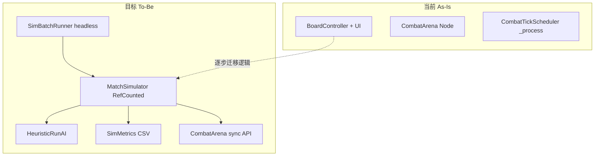

# 自动跑局与 Build 平衡测算方案

## 现状与机会

项目已具备较好的分层基础（见 [ARCHITECTURE.md](Documents/ARCHITECTURE.md)）：

- **纯逻辑层**：`BoardGrid`、`DeckState`、`ShopService`、`RunEconomy`、`UnitBrain`、`DamagePipeline`、`EffectResolver` 均为 `RefCounted`
- **编排层**：[`board_controller.gd`](scripts/core/board_controller.gd) 已实现 SHOP → PREPARE → COMBAT → RESOLVE 全流程，但强耦合 UI
- **战斗层**：[`combat_arena.gd`](scripts/combat/combat_arena.gd) + [`combat_tick_scheduler.gd`](scripts/combat/combat_tick_scheduler.gd)；`presentation=null` 时可跳过动画，但仍依赖 `_process(delta)`

**缺口**（必须先补，否则批量结果不可信）：

| 问题 | 位置 | 影响 |
|------|------|------|
| RNG 未 seed | `CombatArena._ready()`、`BoardController._ready()` | 同 build 多次跑结果不同 |
| Scheduler 时间驱动 | `CombatTickScheduler._process` | headless 慢、步数不可直接控制 |
| instance_id 全局递增 | `UnitInstance` | tie-break 跨局不一致 |
| 寻敌无 tie-break | `BoardGrid.find_nearest_enemy()` | 等距目标时结果不稳定 |



---

## 推荐架构：三层模拟

### 第 1 层 — 单场战斗快测（1–2 天，可独立使用）

用途：验证单个 build 在某波次的胜率/耗时，不跑商店。

- 新建 `CombatSimulator`（`RefCounted`）：封装 grid 初始化、放置单位、`CombatArena.start_combat(presentation=null)`
- 给 `CombatTickScheduler` 增加 **`run_until_finished(max_ticks)`**：循环调用现有 `_process_one_step()`，不依赖 delta
- 暴露 `CombatArena.set_rng(rng)` + 每局 `UnitInstance.reset_instance_id_counter()`

**Build 输入**：`DeckConfig` / 预设 `.tres`（如 [`test_map_deck.tres`](resources/deck/test_map_deck.tres)）+ 固定布阵脚本（前排坦克、后排输出等简单规则）。

**输出指标**：`won`、`combat_ticks`、存活玩家单位数/总 HP/总攻、击杀数、玩家死亡数。

### 第 2 层 — 完整 Run 模拟（核心目标）

新建 **`MatchSimulator`**（`RefCounted`），从 [`board_controller.gd`](scripts/core/board_controller.gd) 迁移无 UI 逻辑：

| 职责 | 复用来源 |
|------|----------|
| 经济 | `RunEconomy` + `EconomyConfig` |
| 商店 | `ShopService.roll_shop` / `try_buy_*` |
| 牌库 | `DeckState` |
| 波次 | `MatchStateMachine` + [`dev_6x6.tres`](resources/levels/dev_6x6.tres) 15 波 |
| 战斗 | `CombatSimulator` |
| 商店技能 | `ShopEffectResolver`（购买/出售/升级触发） |

状态循环（与现有一致）：

```
SHOP(AI决策) → PREPARE(AI布阵) → COMBAT(同步跑完) → RESOLVE → 下一波 / LEVEL_COMPLETE / DEFEAT
```

**关键设计**：`MatchSimulator` 不继承 `Node`，战斗时临时 `CombatArena.new()` 挂到 runner 的 SceneTree 子节点，或把 Scheduler 抽成可注入的 `ICombatDriver` 接口。

### 第 3 层 — 批量与后处理

- 场景：[`scenes/tools/sim_batch_runner.tscn`](scenes/tools/sim_batch_runner.tscn)（极简 Node 根）
- 启动：`godot --headless --path "..." res://scenes/tools/sim_batch_runner.tscn -- --seeds 1-1000 --archetype summon`
- 每 seed 跑 1 次完整 Run → 追加写入 `user://sim_results/run_*.csv`
- Python 分析脚本（放 [`tools/analyze_sim_results.py`](tools/analyze_sim_results.py)）：按波次聚合胜率、金币曲线、build 强度分位数

---

## 启发式 AI 设计（HeuristicRunAI）

AI 不必「像真人」，但必须 **可配置、可复现、可解释**，便于对比流派。

### 配置文件：`SimAIProfile` Resource

```gdscript
# 建议字段
archetype_tags: Array[StringName]   # 如 "summon", "opening", "shop"
priority_units: Array[String]       # 核心卡 id 列表
avoid_units: Array[String]
refresh_policy: enum { NEVER, IF_GOLD_GT_X, LAST_SLOT }
sell_policy: enum { NEVER, LOW_PRIORITY_WHEN_FULL }
buff_preference: enum { STAT, ECONOMY, SKIP }
placement_template: enum { FRONT_TANK_BACK_DPS, CLUSTER, LINE }
```

流派 tag 可复用 [`UNITS_ROSTER.md`](Documents/UNITS_ROSTER.md) 的分类；后续在 `UnitData` 或 sidecar JSON 写入 `archetype_tags`（避免硬编码 42 张卡）。

### 商店决策（每店 visit 一次 pass）

按优先级扫描 character slots + buff slots：

1. **合并优先**：同名可 merge → 必买（经济允许）
2. **核心卡**：`priority_units` 或 tag 匹配 → 分数 += tier_weight × stat_score
3. **填充**：牌库未满时买最高分；满了则卖最低分非核心再买入
4. **刷新**：仅当 `refresh_policy` 允许且最高分 slot < 阈值
5. **增益**：优先加在核心 entry 上；无合适目标则跳过

评分示例（可调参）：

```
score = tag_match * 3 + is_priority * 5 + (atk+hp)/cost + merge_bonus * 10
```

### 布阵决策（PREPARE）

从牌库选 top-N（`max_board_units`，默认 5）：

- **FRONT_TANK_BACK_DPS**：按 HP 降序占前排 y 小格，攻高的占后排
- **CLUSTER**：高协同 tag（召唤/开战）聚邻格
- 利用现有 [`board_grid.place`](scripts/core/board_grid.gd) + [`try_deploy_entry`](scripts/core/board_controller.gd) 逻辑，抽成 `PlacementAI.suggest_layout(deck, grid) -> Array[{entry_id, cell}]`

### 多 AI 对比

同一 seed 跑「召唤流 AI vs 开战流 AI vs 贪心 AI」，对比 **到达第 N 波概率、终局牌库强度**，用于平衡「流派是否过强/过弱」。

---

## 应采集的指标（成长曲线 / 平衡）

### 每波（Run 级 time series）

| 字段 | 用途 |
|------|------|
| `wave_index` | X 轴 |
| `won` | 该波胜率（批量聚合） |
| `gold_before_shop` / `gold_after_shop` | 经济曲线 |
| `deck_size` / `avg_level` / `total_atk` / `total_hp` | 构筑强度曲线 |
| `shop_purchases` / `refresh_count` | AI 行为审计 |
| `combat_ticks` | 战斗难度/时长代理 |
| `player_deaths` / `enemy_kills` | 战损 |
| `defeated` | Run 是否结束 |

### Run 汇总

- `max_wave_reached`、`level_complete`、`final_gold`
- `core_units`（最终牌库 id 列表）
- `seed`、`ai_profile_id`

### 平衡分析用法

- **玩家成长曲线**：对 500+ seed 取 `avg(total_atk)` / `avg(gold)` 按 wave 画 P50/P90 带
- **难度曲线**：`1 - win_rate(wave)` 应对平滑上升；尖峰波次 → 查 [`wave_XX.tres`](resources/levels/) 敌人配置
- **流派平衡**：同 wave 下不同 `SimAIProfile` 的 win_rate / max_wave 对比
- **单位 Tier**：结合现有 [`tools/suggest_unit_tier.py`](tools/suggest_unit_tier.py)，用「被 AI 购买率 × 出现波次 win_rate 提升」校准

---

## 实现顺序（建议 4 个里程碑）

### M1 — 确定性 + 同步战斗（前置，约 1–2 天）

- [`combat_tick_scheduler.gd`](scripts/combat/combat_tick_scheduler.gd)：`run_until_finished()`
- [`combat_arena.gd`](scripts/combat/combat_arena.gd)：`set_rng()` / 去掉 `_ready` 里 unconditional randomize
- [`unit_instance.gd`](scripts/core/unit_instance.gd)：`reset_instance_id_counter()`
- [`board_grid.gd`](scripts/core/board_grid.gd)：寻敌 tie-break（y → x → instance_id）
- 验证：同 seed 连跑 2 次，战斗结果 bit-identical

### M2 — CombatSimulator + 波次扫描（约 1 天）

- 固定 deck + 固定布局，对 [`dev_6x6.tres`](resources/levels/dev_6x6.tres) 15 波各跑 N 次
- 输出 `wave_balance.csv`：先不调商店，只看「给定 build 何时开始输」

### M3 — MatchSimulator + HeuristicRunAI（约 3–5 天）

- 从 `BoardController` 抽取：`_enter_shop_phase`、购买/出售、`_begin_combat_wave`、RESOLVE 发金、defeat 重置
- 实现 `SimAIProfile` + `HeuristicRunAI`
- 单 Run 命令行可跑通

### M4 — 批量 Runner + 分析（约 1–2 天）

- headless batch、CSV 导出、Python 聚合图表
- 文档：[`Documents/SIM_BALANCE.md`](Documents/SIM_BALANCE.md)（如何跑、如何读结果）

---

## 风险与对策

| 风险 | 对策 |
|------|------|
| `BoardController` 抽取工作量大 | 先 **复制** 核心流程到 `MatchSimulator`，稳定后再反向让 Controller 调用 Simulator（避免大爆炸重构） |
| 模态 UI（替换牌库、挂 buff）阻塞 AI | Simulator 内实现 **自动策略**：满库时卖最低分；buff 自动挂核心 entry |
| AI 不像玩家 → 数值偏乐观/悲观 | 多 profile + 参数 sweep；核心卡手动 `priority_units` 校准 |
| headless Godot 加载慢 | 批量时 `--quit-after N runs`；M2 战斗-only 模式做快速筛选 |
| 42 单位技能链复杂 | Metrics 加 `combat_event_counts`（可选），异常波次 dump replay seed |

---

## 不建议的做法

- **不要** 第一版就用 ML/遗传算法做 AI — 调试成本远高于启发式，且难以解释平衡结论
- **不要** 在 Python 里重写战斗逻辑 — 会与 Godot 真实规则漂移
- **不要** 跳过确定性改造直接跑 1000 局 — 方差会淹没 build 差异
- **不要** 一开始就做可视化 Dashboard — CSV + Jupyter/Excel 足够验证 M3

---

## 最小验证标准（M3 完成时）

1. `godot --headless ... -- --seed 42 --profile summon` 输出完整 15 波或 defeat 的 CSV 行
2. 同 seed 重跑结果完全一致
3. 召唤流 profile 在 mid-game 的 `total_atk` 曲线明显高于随机购买 baseline
4. 能一眼看出「第几波 win_rate 跌破 80%」用于调 [`wave_data`](scripts/data/wave_data.gd) / 经济
