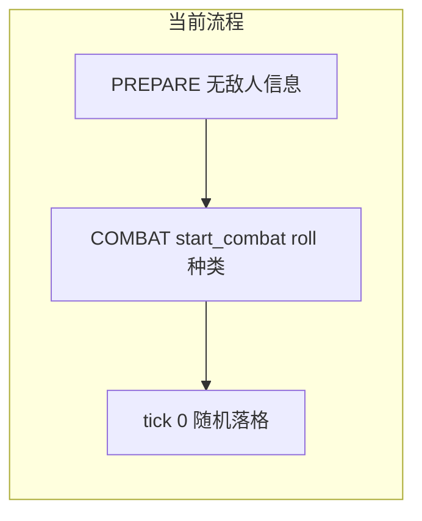
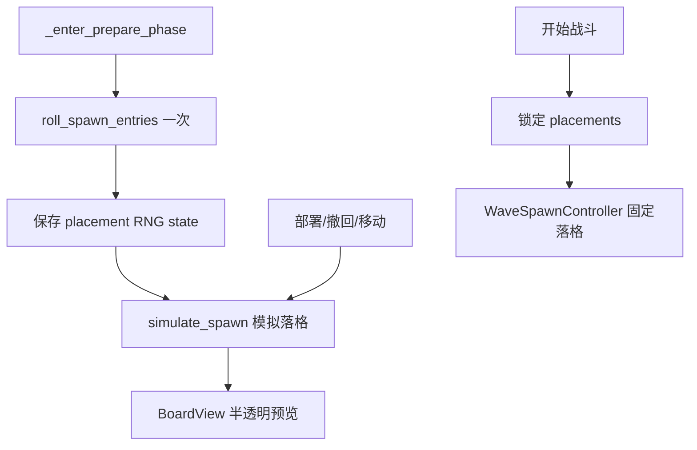

# 部署阶段显示敌人及位置

## 现状

- 对局阶段：`SHOP → PREPARE（部署）→ COMBAT → RESOLVE`（[`match_state_machine.gd`](scripts/core/match_state_machine.gd)）
- 部署阶段（[`board_controller.gd`](scripts/core/board_controller.gd) 的 `_enter_prepare_phase`）仅显示己方牌库与棋盘，状态栏只有波次编号
- 敌人组合在 [`CombatArena.start_combat`](scripts/combat/combat_arena.gd) 时由 [`WaveData.roll_spawn_entries`](scripts/data/wave_data.gd) 随机决定
- 格子位置在战斗 **tick 0** 才由 [`SpawnSystem.spawn_entry`](scripts/core/spawn_system.gd) 从**当前空格**随机选取
- 玩家在部署阶段**看不到**敌人种类与落点



## 目标行为

1. 进入 **PREPARE** 时预 roll 本波敌人种类（与现有 `WaveData` + 商店角色池逻辑一致）
2. 根据**当前棋盘上的己方单位**模拟 tick 0 刷怪，得到每个敌人的格子坐标
3. 在 [`BoardView`](scripts/ui/board_view.gd) 上以**半透明敌人卡片**显示预览（复用现有 ENEMY 配色，见 [`unit_card_display.gd`](scripts/ui/unit_card_display.gd) 的 `COLOR_ENEMY`）
4. 玩家部署/撤回/移动单位时**重新模拟落点**（空格集合变化，预览位置随之更新；玩家可「抢」预览格，敌人会改落别处）
5. 点击「开始第 N 波」时**锁定**最后一次预览的落点，战斗 tick 0 **按固定坐标放置**，不再二次随机——保证预览与实战一致



## 核心改动

### 1. 扩展刷怪逻辑 — [`spawn_system.gd`](scripts/core/spawn_system.gd)

新增两个静态方法，抽取现有 `spawn_entry` 的落格算法，避免重复：

- **`simulate_spawn_entries(grid, entries, rng) -> Array[Dictionary]`**  
  不写入 `BoardGrid`，返回 `[{ "unit": UnitData, "cell": Vector2i }, ...]`。逻辑与现有 `spawn_entry` 相同：每次从当前空格洗牌取首格；格满则少刷。

- **`spawn_at_placements(grid, placements) -> Array[UnitInstance]`**  
  按给定坐标创建 `Team.ENEMY` 实例并 `place`；供战斗 tick 0 使用。

现有 `spawn_entry` 内部可改为调用 simulate + place，保持行为不变。

### 2. 固定落格刷怪 — [`wave_spawn_controller.gd`](scripts/combat/wave_spawn_controller.gd)

- 增加 `_fixed_placements: Array` 字段
- `setup(...)` 增加可选参数 `fixed_placements: Array = []`
- `process_tick(0)` 分支：
  - 若 `_fixed_placements` 非空 → 调用 `SpawnSystem.spawn_at_placements`
  - 否则 → 保持现有随机 `spawn_entry`（兼容 headless/测试）

### 3. 战斗入口传参 — [`combat_arena.gd`](scripts/combat/combat_arena.gd)

`start_combat(...)` 增加可选参数 `fixed_placements: Array = []`，传给 `_spawn_controller.setup(...)`。

### 4. 棋盘预览层 — [`board_view.gd`](scripts/ui/board_view.gd)

- 新增 `_preview_nodes: Array[Node2D]` 与 `set_enemy_preview(placements)` / `clear_enemy_preview()`
- 预览实现：为每个 placement 创建临时 `UnitInstance.from_unit_data(..., ENEMY)`（**不**加入 `BoardGrid`），实例化 `UnitBoardDisplay`，设置 `modulate.a ≈ 0.55`、较高 `z_index`、忽略鼠标
- `refresh()` / `sync_units()` 时保留预览层（预览与 grid 单位分离）
- 离开 PREPARE 或开战前调用 `clear_enemy_preview()`

可选小 polish：在 [`unit_card_display.gd`](scripts/ui/unit_card_display.gd) 加 `set_preview_mode(bool)` 显示虚线描边，与拖拽 ghost 风格统一（非必须）。

### 5. 对局流程编排 — [`board_controller.gd`](scripts/core/board_controller.gd)

新增状态字段：

```gdscript
var _pending_wave_entries: Array[SpawnScheduleEntry] = []
var _wave_placement_rng_state: int = 0
var _locked_spawn_placements: Array = []
```

新增方法：

| 方法 | 时机 |
|------|------|
| `_roll_wave_preview()` | `_enter_prepare_phase`、`_on_finish_shop_pressed` 后 |
| `_refresh_enemy_preview()` | roll 后、每次 `try_deploy_entry` / `try_withdraw_at` / `try_reposition_unit` 成功后 |
| `_clear_wave_preview()` | 进入 SHOP/COMBAT、战斗结束清场时 |

**`_roll_wave_preview()` 逻辑：**
- 读取 `match_state.get_current_wave(level_data)` 与 `_get_enemy_spawn_pool()`
- `_pending_wave_entries = wave.roll_spawn_entries(..., _rng)`
- `_wave_placement_rng_state = _rng.state`（Godot 4 `RandomNumberGenerator.state`）
- 调用 `_refresh_enemy_preview()`

**`_refresh_enemy_preview()` 逻辑：**
- 用独立 RNG，`rng.state = _wave_placement_rng_state`
- `placements = SpawnSystem.simulate_spawn_entries(board_grid, _pending_wave_entries, rng)`
- `_board_view.set_enemy_preview(placements)`
- 更新状态栏，例如：`"部署阶段：本波敌人 %d 个（半透明预览），完成后开始第 %d 波"`，并可附敌人名称摘要

**`_on_start_combat_pressed()` 修改：**
- 开战前再调用一次 `_refresh_enemy_preview()` 锁定落点
- `_locked_spawn_placements = placements`（存副本）
- `_clear_wave_preview()` 清除半透明层（避免与真实单位重叠）
- `_begin_combat_wave()` 传入 `_locked_spawn_placements`

**`_begin_combat_wave()` 修改：**
- `_combat_arena.start_combat(..., _locked_spawn_placements)`
- 战斗 tick 0 直接按锁定坐标刷怪，无需再次 roll

### 6. UI 文案微调

- [`_on_finish_shop_pressed`](scripts/core/board_controller.gd) 状态提示加入敌人预览说明
- [`HandPanel`](scripts/ui/hand_panel.gd) 标题可选补充「红色半透明为下波敌人」（低优先级，状态栏已足够）

## 关键设计决策

| 决策 | 选择 | 理由 |
|------|------|------|
| 预览是否写入 BoardGrid | 否，纯视觉层 | 玩家仍可占据预览格，符合「空闲格刷怪」规则 |
| 落点是否随己方移动更新 | 是 | 与 `get_empty_cells()` 逻辑一致 |
| 开战落点 | 锁定最后一次预览 | 避免 preview 与实战不一致 |
| 敌人种类 roll 时机 | 进入 PREPARE 一次 | 与现有 `WaveSpawnController.setup` 行为对齐 |
| RNG | 种类 roll 后保存 `state`，每次预览重置 placement RNG | 保证同一布局下预览可复现，且与开战落点一致 |

## 涉及文件

| 文件 | 变更 |
|------|------|
| [`scripts/core/spawn_system.gd`](scripts/core/spawn_system.gd) | simulate + fixed spawn |
| [`scripts/combat/wave_spawn_controller.gd`](scripts/combat/wave_spawn_controller.gd) | 固定落格分支 |
| [`scripts/combat/combat_arena.gd`](scripts/combat/combat_arena.gd) | 透传 placements |
| [`scripts/ui/board_view.gd`](scripts/ui/board_view.gd) | 预览层 API |
| [`scripts/core/board_controller.gd`](scripts/core/board_controller.gd) | 生命周期与锁定 |
| （可选）[`scripts/ui/unit_card_display.gd`](scripts/ui/unit_card_display.gd) | preview 描边 |

## 验证方式

1. 商店 → 部署：棋盘上出现半透明红色敌人卡片，数量等于 `WaveData.spawn_count`（合并同种后按只数展开）
2. 移动/撤回己方单位：敌人预览位置随之变化，种类不变
3. 占据预览格：该预览敌人改落其他空格
4. 开始战斗：预览消失，tick 0 敌人在**相同格子**出现（无 pop 动画也可接受，或保留现有 spawn 动画）
5. 波次胜利 → 商店 → 下一波部署：预览刷新为新波次敌人
6. 敌人池为空 / 波次缺失：无预览，状态栏给出 warning（与现有 `WaveData` warning 一致）

## 不在本次范围

- 侧边栏敌人列表面板（用户要求的是棋盘位置）
- 修改刷怪算法（仍全局随机空格，无敌方半场分区）
- 实现文档中的 `DrawService` 每波抽 5 张
